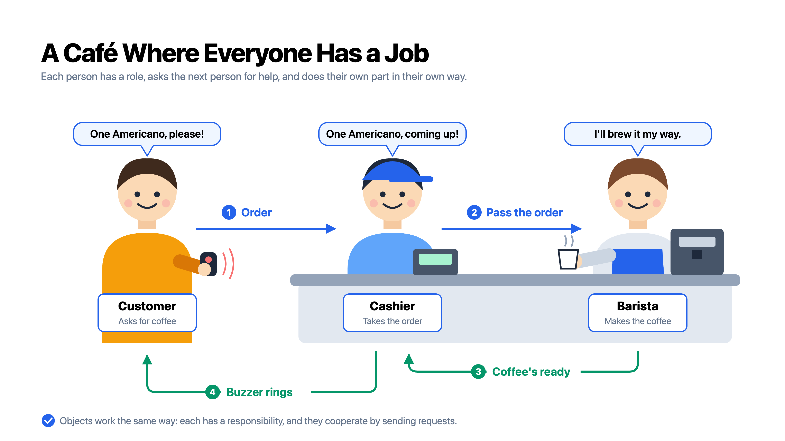

## 시작 전에

요즘 책을 꾸준히 읽으려고 노력하고 있습니다. 그래서 사 두고 미뤄 두었던 `객체지향의 사실과 오해`를 먼저 읽고, 이어서 `오브젝트`를 읽으며 객체지향을 제대로 공부해 보려고 합니다.

읽기 전에 **"AI가 코드를 다 짜 주는 시대에도 이 개념이 필요할까?"**라는 고민이 들었습니다. 결론은 "그래도 알아야 한다"였습니다. AI에게 코드 작성 지침을 줄 때, 제가 먼저 객체지향을 이해하고 있어야 AI가 객체지향적인 코드를 짜도록 이끌 수 있다고 생각했기 때문입니다.

첫 번째 글의 주제는 1장 '협력하는 객체들의 공동체'입니다. 객체지향은 흔히 "현실 세계를 모방하는 것"이라고 설명합니다. 책은 이 말이 왜 오해인지부터 짚고 객체지향의 핵심은 클래스가 아니라 **역할과 책임을 가진 객체들이 서로 협력하는 것**이라고 말합니다.

## 객체지향은 실세계의 모방일까?

{: w="3840" h="2160" }
_한국에서는 손님의 주문을 받아 주는 사람이 바리스타 역할도 같이 하긴 하지만..ㅎㅎ 학습용으로 참고만!_

객체지향을 공부할 때 실세계에 비유하는 가장 큰 이유는 **객체지향의 기본 생각을 이해하고 학습하는 데 매우 효과적이기 때문**입니다.

위의 그림을 보면 카페에서 손님은 캐셔에게 주문하고, 캐셔는 바리스타에게 주문을 넘기고, 바리스타는 자기 방식대로 커피를 만듭니다. 이 그림이 말하고자 하는 바는 **"각자 맡은 일이 있고, 서로 부탁하며 함께 일한다"**입니다.

하지만 책은 실세계 비유가 실무에서 객체지향 분석과 설계를 설명하기에는 적합하지 않다고 말합니다. 그 이유는 아래와 같습니다.

- 애플리케이션을 개발하면서 객체와 직접 대응되는 실세계의 사물을 발견할 확률이 그다지 높지 않습니다.
- 그런 사물이 있더라도, 객체와 사물 사이의 개념적 거리는 비슷한 점을 찾기 어려울 만큼 먼 것이 보통입니다.

예를 들어 현실의 은행 계좌는 스스로 아무것도 하지 못하는 기록일 뿐입니다. 반면 소프트웨어의 `Account` 객체는 잔액이 부족하면 출금 요청을 스스로 거절합니다. 이름은 같아도 하는 일은 전혀 다른 셈입니다.

그렇다고 실세계 비유가 쓸모없는 것은 아닙니다. 설계 방법으로는 맞지 않지만 객체지향이 무엇을 말하려는지 감을 잡는 데는 여전히 좋은 출발점입니다. 그래서 책도 현실의 카페 이야기로 1장을 시작합니다.

## 협력하는 사람들

위의 카페 그림을 순서대로 따라가 보겠습니다.

1. 손님이 캐셔에게 아메리카노를 주문합니다.
2. 캐셔는 주문을 받고 바리스타에게 커피를 만들어 달라고 요청합니다.
3. 바리스타는 자기 방식대로 커피를 만들어 캐셔에게 넘깁니다.
4. 캐셔는 진동벨을 울려 손님에게 커피가 준비됐다고 알립니다.

이 흐름에서 눈여겨볼 점은 **손님의 요청 하나가 또 다른 요청으로 이어진다**는 것입니다. 손님의 주문은 캐셔가 바리스타에게 보내는 요청이 되고 바리스타가 만든 커피는 거꾸로 캐셔를 거쳐 손님에게 돌아옵니다. 이렇게 누군가에게 부탁하고(요청), 그 결과를 돌려받는(응답) 일이 줄줄이 이어집니다.

또 하나는 **누구도 혼자서 모든 일을 하지 않는다**는 점입니다. 손님은 커피를 어떻게 만드는지 모르고 캐셔도 바리스타의 레시피를 모릅니다. 각자 자기가 맡은 일만 알고 나머지는 다른 사람에게 부탁합니다.

그래서 이 협력이 성공하려면 각자 맡은 일을 해내야 합니다. 캐셔가 주문을 잘못 넘기거나 바리스타가 커피를 만들지 않으면, 손님은 끝내 커피를 받지 못합니다.

{: .prompt-tip }

> 카페의 사람들은 **"손님에게 커피를 내준다"는 목표**를 위해, 서로 **요청하고 응답하며** 협력합니다. 그리고 이 협력은 각자 맡은 일을 해낼 때만 성공합니다.

책에서는 이것을 **역할, 책임, 협력**이라고 부릅니다.

## 역할, 책임, 협력

앞의 카페 장면을 세 단어로 나눠 보겠습니다.

| 개념     | 뜻                                                                  | 카페에서는                                   |
| -------- | ------------------------------------------------------------------- | -------------------------------------------- |
| **협력** | 목표를 이루려고 여러 사람이 요청과 응답을 주고받으며 함께 일하는 것 | 손님에게 커피 한 잔을 내주는 전체 과정       |
| **책임** | 요청을 받았을 때 해내야 하는 일                                     | 바리스타는 커피를 만든다 (자세한 건 아래 표) |
| **역할** | 비슷한 책임을 하나로 묶어 붙인 이름                                 | 손님, 캐셔, 바리스타                         |

정리하면, 사람들은 **협력**하려고 서로 요청을 보내고 요청을 받은 사람은 그 일을 해낼 **책임**을 집니다. 그리고 이런 책임들을 묶은 것이 **역할**입니다.

카페의 세 역할이 어떤 요청을 받고 어떤 책임을 지는지 표로 보면 다음과 같습니다.

| 역할         | 받는 요청             | 책임 (해내야 하는 일)                                          | 이어서 보내는 요청          |
| ------------ | --------------------- | -------------------------------------------------------------- | --------------------------- |
| **캐셔**     | 손님의 주문           | 주문을 받아 바리스타에게 넘기고, 커피가 나오면 손님에게 알린다 | 바리스타에게 커피 제조 요청 |
| **바리스타** | 캐셔의 커피 제조 요청 | 주문받은 커피를 자기 방식대로 만들어 캐셔에게 넘긴다           | 없음                        |
| **손님**     | 캐셔의 알림(진동벨)   | 커피를 받아 간다                                               | 없음                        |

### 역할이 있으면 좋은 점

책은 역할이라는 개념을 쓰면 협력을 더 유연하게 설명할 수 있다고 말합니다. 카페에 빗대면 다음과 같습니다.

- **여러 사람이 같은 역할을 맡을 수 있습니다.** 바리스타가 여러 명이어도 손님은 신경 쓰지 않습니다.
- **역할은 대신할 수 있다는 뜻입니다.** 오늘 바리스타가 쉬어도, 다른 바리스타가 그 자리를 채우면 협력은 그대로 이어집니다.
- **책임을 해내는 방법은 각자 정합니다.** 같은 아메리카노 주문이어도 바리스타마다 만드는 방식은 조금씩 다를 수 있습니다.
- **한 사람이 여러 역할을 맡을 수 있습니다.** 그림 아래에 적었듯, 작은 카페에서는 주문을 받는 사람이 바리스타 역할까지 함께 합니다.

여기서 중요한 점은 손님이 **"누가"** 커피를 만드는지가 아니라 **"바리스타 역할을 하는 누군가"**에게 부탁한다는 것입니다. 손님은 역할만 알면 되고 그 역할을 실제로 누가 어떻게 해내는지는 몰라도 됩니다.

### 사람을 객체로 바꿔 보면

지금까지는 카페의 사람들 이야기였습니다. 이제 단어 몇 개만 바꿔 보겠습니다.

| 카페에서는                | 객체지향에서는 |
| ------------------------- | -------------- |
| 사람                      | 객체           |
| 다른 사람에게 보내는 요청 | 메시지         |
| 요청을 처리하는 방법      | 메서드         |

이렇게 바꾸면 카페 이야기가 그대로 객체 이야기가 됩니다. 객체들은 애플리케이션의 **기능을 구현하려고 협력**합니다. 이때 큰 기능은 **더 작은 책임**으로 나뉘고, 각 책임은 그에 맞는 역할을 맡은 객체가 해냅니다.

객체도 자기 책임을 다하는 데 도움이 필요하면, 다른 객체에 **메시지**를 보내 요청합니다. 메시지를 받은 객체는 자기 **메서드**로 그 일을 처리하고 결과를 돌려줍니다(응답). 손님이 바리스타 역할만 알면 됐듯이, 메시지를 보내는 객체도 상대의 역할만 알면 됩니다. 상대가 어떤 메서드로 처리하는지는 몰라도 됩니다.

앞에서 본 역할의 특징도 객체에 그대로 들어맞습니다.

- **여러 객체가 같은 역할을 맡을 수 있습니다.**
- **역할은 대체 가능성을 뜻합니다.** 같은 역할을 하는 다른 객체로 바꿔도 협력은 그대로 이어집니다.
- **책임을 해내는 방법은 각 객체가 스스로 정합니다.** 같은 메시지를 받아도 객체마다 다른 메서드로 처리할 수 있습니다.
- **한 객체가 여러 역할을 동시에 맡을 수 있습니다.**

이 중 두 번째와 세 번째 특징을 함께 보면, 객체지향의 중요한 개념인 **다형성(polymorphism)**이 나옵니다. 다형성은 **같은 메시지를 받아도 객체마다 다른 방식으로 처리할 수 있는 성질**입니다.

카페로 돌아가 보면, 캐셔는 "아메리카노 한 잔"이라는 같은 요청을 바리스타 역할을 맡은 누구에게나 보낼 수 있습니다. 바리스타마다 만드는 방법이 조금씩 달라도, 캐셔는 아메리카노만 받으면 됩니다. 이렇게 요청을 보내는 쪽이 상대의 **역할**만 알고 **방법**은 모르기 때문에, 그 역할을 해내는 객체를 얼마든지 바꿔 끼울 수 있습니다. 즉, 역할의 **대체 가능성**은 다형성이 있기에 가능합니다.

{: .prompt-tip }

> 한마디로 객체지향의 객체는 **역할과 책임을 맡아 다른 객체와 협력하는 존재**입니다.

## 협력 속에 사는 객체

앞에서 객체를 "협력하는 존재"라고 정리했습니다.
책에서는 객체가 가져야 할 2가지 덕목을 언급했습니다.

- **충분히 협력적이어야 합니다.** 객체는 모든 일을 혼자 처리하는 전지전능한 존재가 아닙니다. 자기 힘으로 할 수 없는 일은 다른 객체에 요청하고 다른 객체가 보낸 요청에는 성실히 응답합니다.
- **충분히 자율적이어야 합니다.** 요청을 받았을 때 그 일을 **어떻게** 해낼지는 객체 스스로 정합니다. 시키는 방식 그대로만 움직이는 존재가 아닙니다.

카페로 돌아가 보면, 캐셔는 바리스타에게 "아메리카노 한 잔 부탁해요"라고만 말합니다. 원두를 얼마나 쓸지, 몇 초 동안 추출할지는 바리스타가 정합니다. 바리스타는 캐셔의 요청을 받아들인다는 점에서 협력적이고, 만드는 방법을 스스로 정한다는 점에서 자율적입니다.

### 상태와 행동을 함께 가진 객체

그렇다면 객체는 어떻게 자율적일 수 있을까요? 책은 그 답을 객체의 구성에서 찾습니다. 객체는 **상태**와 **행동**을 함께 가집니다.

- **상태**: 객체가 기억하고 있는 정보입니다. (예: 계좌의 잔액)
- **행동**: 그 정보를 가지고 객체가 할 수 있는 일입니다. (예: 입금, 출금)

여기서 중요한 점은 **객체가 자기 상태를 스스로 관리한다**는 것입니다. 다른 객체는 그 상태를 직접 바꿀 수 없고 행동을 해 달라고 요청할 수만 있습니다.

앞에서 든 `Account` 예시를 다시 보겠습니다. 다른 객체가 잔액 값을 직접 꺼내서 빼는 것이 아니라, 계좌에 "10,000원 출금해 줘"라고 요청합니다. 그러면 계좌는 자기 잔액을 확인하고 부족하면 **스스로** 요청을 거절합니다. 잔액이라는 상태와 출금이라는 행동이 한 객체 안에 묶여 있기 때문에 가능한 일입니다.

```java
public class Account {
    private long balance; // 상태: 밖에서 직접 바꿀 수 없다

    public void withdraw(long amount) { // 행동: 출금 요청을 받는 창구
        if (balance < amount) {
            throw new IllegalStateException("잔액이 부족합니다.");
        }
        balance -= amount;
    }
}
```

다른 객체는 `account.balance -= 10000`처럼 잔액을 직접 바꿀 수 없습니다. `account.withdraw(10000)`으로 요청을 보낼 수 있을 뿐이고 받아들일지 말지는 `Account`가 정합니다.

데이터와 그 데이터를 처리하는 코드를 따로 두던 절차지향 방식과 달리, 객체지향은 이 둘을 하나의 객체로 묶습니다. 그래서 객체는 외부의 간섭 없이 자기 일을 스스로 판단할 수 있습니다.

### 메시지와 메서드를 나누는 이유

앞에서 객체끼리 주고받는 요청을 **메시지**, 요청을 처리하는 방법을 **메서드**라고 부른다고 했습니다. 이 둘을 굳이 나눠 부르는 데에는 이유가 있습니다.

- **메시지**는 보내는 쪽이 정합니다. "무엇을" 원하는지만 담습니다.
- **메서드**는 받는 쪽이 정합니다. "어떻게" 할지를 담습니다.

보내는 쪽은 "출금해 줘"라는 메시지만 보낼 뿐, 계좌가 잔액을 어떻게 확인하고 어떻게 줄이는지는 모릅니다. 알 필요도 없습니다. 덕분에 받는 쪽은 처리 방법을 자유롭게 고르거나 나중에 바꿀 수 있습니다. 메시지와 메서드가 나뉘어 있기에 객체가 **자율적**일 수 있는 것입니다.

이렇게 바깥에는 "어떤 요청을 받을 수 있는지"만 보여 주고 "어떻게 처리하는지"는 안에 숨기는 것을 **캡슐화**라고 합니다.

{: .prompt-tip }

> 객체는 **협력하기 위해 다른 객체에 메시지를 보내지만** 받은 메시지를 **어떻게 처리할지는 스스로 결정**합니다. 협력성과 자율성을 모두 갖춰야 좋은 객체입니다.

## 객체지향의 본질

지금까지 카페 이야기에서 출발해 역할, 책임, 협력, 그리고 자율적인 객체까지 살펴봤습니다. 책에서는 객체지향의 본질을 다음과 같이 정리합니다.

- 객체지향은 시스템을 **자율적인 객체들이 협력하는 공동체**로 보고 객체 단위로 시스템을 나누는 방법입니다.
- **자율적인 객체**란 상태와 행동을 함께 가지고, 자기 일을 스스로 책임지는 객체입니다.
- 객체는 기능을 구현하려고 다른 객체와 **협력**하고 협력 안에서 **역할**을 맡습니다. 역할은 관련된 **책임**을 묶은 것입니다.
- 객체는 **메시지**를 보내 협력하고 메시지를 받은 객체는 그 메시지를 처리할 **메서드**를 스스로 고릅니다.

### 객체지향 = 클래스? 이런 생각은 이제 버리자

> 이 글을 쓰고 있는 저도 객체지향 하면 가장 먼저 떠오르는 게 클래스..

객체지향을 처음 배우면 보통 클래스부터 배웁니다. 그래서 많은 사람이 객체지향을 "클래스를 잘 설계하는 것"으로 생각합니다. 책은 이것을 **오해**라고 말합니다.

클래스는 객체를 만드는 **도구**일 뿐입니다. 실제로 클래스 없이 객체를 만드는 언어도 있습니다. 예를 들어 JavaScript는 원래 클래스 없이, 이미 있는 객체를 본떠 새 객체를 만드는 **프로토타입** 방식을 썼습니다. 지금도 아래처럼 클래스를 정의하지 않고 객체를 바로 만들어 메시지를 보낼 수 있습니다.

```javascript
const barista = {
  makeCoffee(menu) {
    return `${menu} 한 잔 나왔습니다.`;
  },
};

barista.makeCoffee("아메리카노"); // 메시지를 보내면, 바리스타가 알아서 처리한다
```

클래스가 없어도 객체는 메시지를 받고 자기 방식대로 처리합니다. 객체지향의 중심에 있는 것은 클래스가 아니라 이렇게 **메시지를 주고받는 객체**입니다.

그래서 설계할 때는 "어떤 클래스가 필요할까?"보다 **"어떤 객체들이 어떤 메시지를 주고받으며 협력할까?"**를 먼저 물어야 합니다. 책은 클래스의 관점에서 메시지를 주고받는 객체의 관점으로 **생각의 중심을 옮기는 것**이 좋은 객체지향 설계의 첫걸음이라고 말합니다.

{: .prompt-tip }

> 객체지향의 중심은 클래스가 아니라 **메시지를 주고받으며 협력하는 객체**입니다. 클래스는 그 객체를 만드는 도구일 뿐입니다.

## 마무리를 하면서

저는 개인적으로는 이런 성격의 책을 많이 어려워하는 것 같습니다. 어릴때부터 책을 거의 기피하면서 살았어서 그런가 추상적인 내용을 담은 책들이 조금 어렵게 느껴지는 것 같습니다.
그렇지만 AI와 함께 학습하고, 천천히 생각해보면 두통은 오지만 조금씩 이해가 되고 있는 것 같다는 생각이 들고 있습니다.

앞으로도 꾸준히 읽고 각 챕터별로 내용을 정리해보려고 합니다. 감사합니다.
