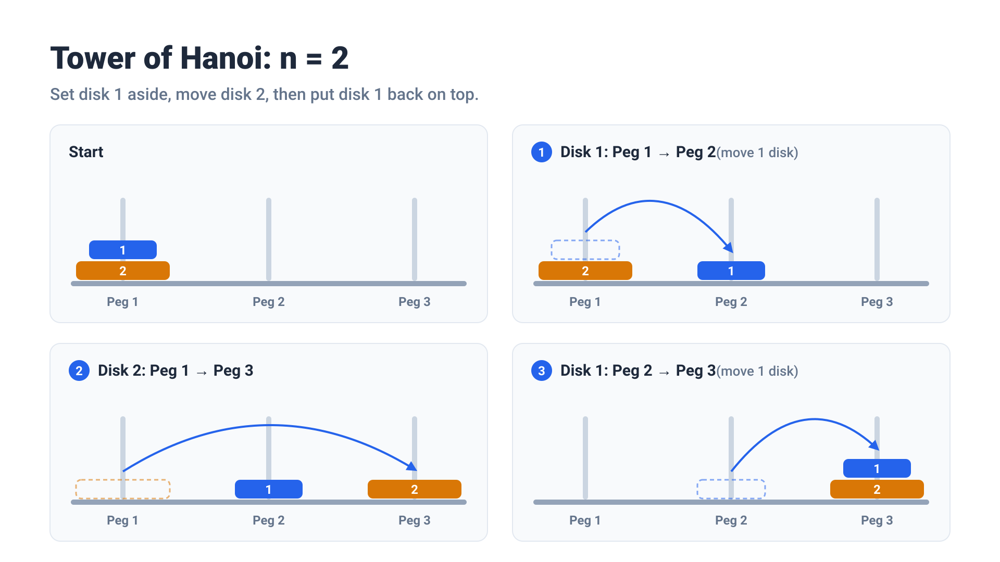
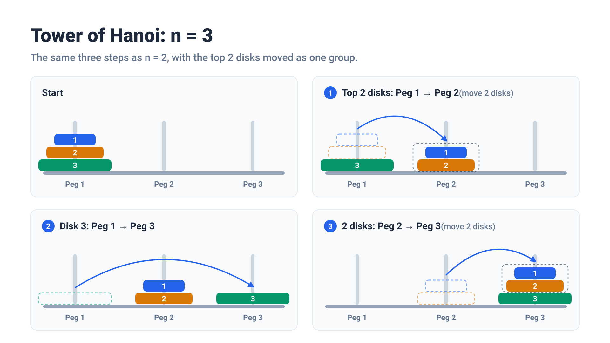
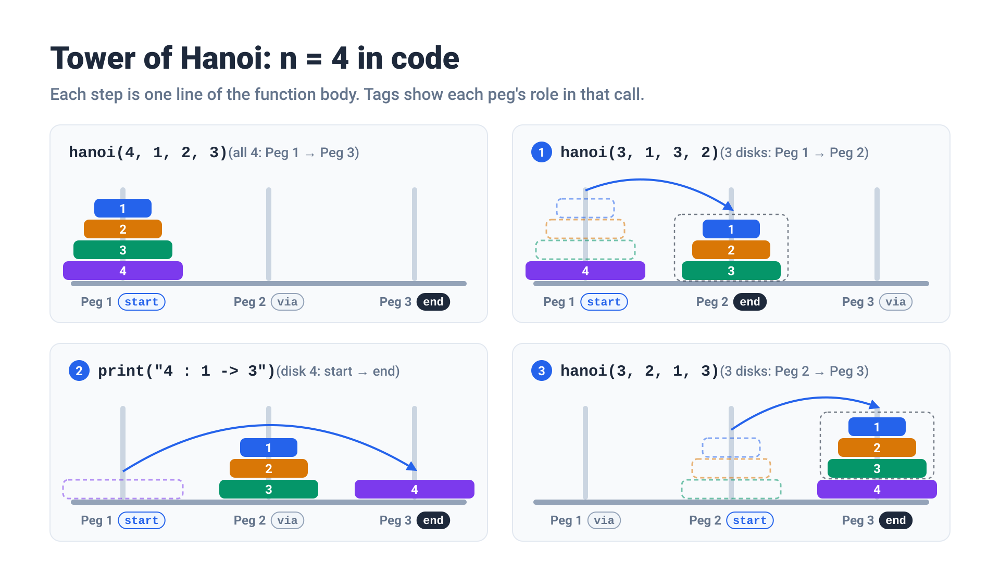

## 시작 전에

[정올 1161번 하노이 탑 문제](https://jungol.co.kr/problem/1161?cursor=IjYiLDgsNA==)를 풀었습니다. 워낙 유명한 문제라 재귀를 공부하면 한 번쯤 꼭 만나게 됩니다.

규칙은 간단합니다.

- 기둥이 3개 있고 1번 기둥에 크기가 다른 원판 N개가 큰 것부터 쌓여 있습니다.
- **한 번에 원판 하나만, 맨 위에 있는 원판만 옮길 수 있습니다.**
- **큰 원판은 작은 원판 위에 올라갈 수 없습니다.**
- 원판 N개를 전부 3번 기둥으로 옮기는 과정을 `원판번호 : 출발 -> 도착` 형식으로 출력합니다.

최근에 AI를 적극적으로 활용하면서 직접 코드를 칠 일이 없다 보니 머리가 녹아내리는 것 같아서, 코딩테스트 문제를 파이썬으로 조금씩 풀어보고 있습니다.
오랜만에 풀려고 하니까 손을 댈 수가 없었던.... 함수 이름만 `hanoi`로 쓰고 한 30분을 멍때린 거 같습니다 ㅋㅋㅋ

결국은 풀지 못했고, AI에게 힌트를 얻어서 풀긴 했습니다.
**이번 포스팅에서는 처음으로 코딩테스트 풀이를 올려 보려고 합니다. 정답 풀이보다는 어디서 막혔고 어떻게 이해했는지를 적어보려고 합니다.**

## 처음에 어떻게 접근했는가?

그냥 냅다 원판 4개일 때, 5개일 때 어떻게 옮기지 하면서 그림을 그려 가며 풀었습니다. "IQ 테스트 하는 것 같다... 난 IQ가 정말 낮은 사람이구나..." 하면서 30분간 그림 그리기 연습을 했습니다. 심지어 재귀 문제라는 건 알고 있었는데도, 처음엔 재귀로 풀어야겠다는 생각조차 하지 못했습니다.

뭔가 특별한 규칙을 찾지 못해서, 결국 AI에게 힌트를 얻어 문제 풀이를 시작했습니다.

## AI가 말하길: "n-1개를 옮기는 방법은 안다고 믿어라"?

> **"n-1개를 옮기는 방법은 이미 안다"고 믿고, n개를 옮기는 방법만 생각하면 됩니다.**

Claude Code가 저에게 첫 번째로 준 힌트 문장입니다. (필자 답변: **"너 나랑 말장난하냐?"**)
그만큼 새대가리라.. 이해를 전혀 하지 못했습니다. (역시 AI는 문제가 없어. 문제는 항상 나한테 있어)

결론적으로 이걸 알고 생각해보면 정말 간단합니다. 간단하게 예시를 따라가보겠습니다.

### N = 1

바로 옮길 수 있으니 패스할게욥!

### N = 2

> 우리는 1개 옮기는 방법을 알고 있다고 생각합시다.

{: w="1920" h="1080" }

1. 1번 원판을 1 → 2로 치워 둔다 (1개 옮기기)
2. 2번 원판을 1 → 3으로 옮긴다
3. 1번 원판을 2 → 3으로 올린다 (1개 옮기기)

### N = 3

> 우리는 2개 옮기는 방법을 알고 있다고 생각합시다.

{: w="1920" h="1080" }

1. 위의 2개를 1 → 2로 치워 둔다 (2개 옮기기)
2. 3번 원판을 1 → 3으로 옮긴다
3. 2개를 2 → 3으로 올린다 (2개 옮기기)

뭔가 비슷한 게 보이시나요?

- 위의 N-1개 원판을 중간 기둥에 잠깐 모셔둔다.
- N번 원판(바닥 원판)을 마지막 기둥에 옮긴다.
- 중간 기둥에 있는 원판들을 마지막 기둥으로 옮긴다.

{: .prompt-info }

> 물론 조건에 `한 번에 원판 하나만, 맨 위에 있는 원판만 옮길 수 있습니다.`라고 되어 있으니, 2개를 한 번에 들어서 옮기는 건 불가능합니다.
> 그림의 "2개 옮기기"는 실제로는 위에서 본 N=2 과정, 즉 원판을 하나씩 세 번 옮기는 걸 줄여서 그린 겁니다.
>
> 이렇게 줄여서 생각해도 되는 이유는, 2개를 옮기는 동안 3번 원판은 맨 아래에 가만히 있기 때문입니다.
> 3번 원판은 1, 2번보다 크니까 어디에 깔려 있든 상관없습니다.

원판이 4개일 때, 5개일 때 모두 동일하게 생각해보면 됩니다.

이게 해설을 보면 머릿속으로는 이해가 되는데 저처럼 코드를 직접 짜게 될 때 뇌정지가 오시는 분들이 계실 거라고 조심스럽게 생각해봅니다.
이번 포스팅을 통해 같이 연습을 해봅시다.

지금까지의 내용만 보고 이해가 완벽하게 되면 좋은데 전 그러지 못했습니다.
저는 아래와 같은 궁금증을 가지게 되었습니다.

## N=4일 때 원판이 움직이는 과정에 N=3 과정이 그대로 안 들어가는데요?

위에서 이야기한 대로 이해해보면, N=4일 때 과정은 `N=3 과정 + 4번 원판 옮기기 + N=3 과정`입니다.
그래서 직접 손으로 써봤는데, N=4 안에 N=3 과정이 그대로 들어있지 않았습니다.

N=3은 이렇게 시작합니다.

```
1 : 1 -> 3
2 : 1 -> 2
...
```

N=4는 이렇게 시작합니다.

```
1 : 1 -> 2
2 : 1 -> 3
...
```

알고 보니 **이동 순서는 같고, 기둥 번호만 달랐습니다.** N=3 기록에서 기둥 번호 2와 3을 서로 바꾸면 N=4의 앞부분이 됩니다. 원판 번호와 1번 기둥은 그대로 둡니다.

| 순서 | N=3 기록          | 2 ↔ 3 바꾸면 (N=4의 앞부분) |
| ---- | ----------------- | --------------------------- |
| 1    | 1 : 1 → **3**     | 1 : 1 → **2**               |
| 2    | 2 : 1 → **2**     | 2 : 1 → **3**               |
| 3    | 1 : **3** → **2** | 1 : **2** → **3**           |
| 4    | 3 : 1 → **3**     | 3 : 1 → **2**               |
| 5    | 1 : **2** → 1     | 1 : **3** → 1               |
| 6    | 2 : **2** → **3** | 2 : **3** → **2**           |
| 7    | 1 : 1 → **3**     | 1 : 1 → **2**               |

오른쪽 열은 N=4를 손으로 풀었을 때의 앞부분 7줄과 정확히 같습니다. 원판 3개를 옮기는 방법 자체는 하나도 달라지지 않았고, 기둥 번호만 바뀐 겁니다.

기둥 번호가 바뀌는 이유는 3개를 보내는 곳이 다르기 때문입니다. N=3 문제에서는 3개를 3번 기둥으로 보냈지만, N=4에서는 3번 기둥을 4번 원판 자리로 비워 둬야 합니다. 그래서 위의 3개는 3번이 아니라 2번 기둥으로 가고, 위의 표에서도 목적지가 2와 3이 바뀝니다.

## 코드로 옮겨보기

코드는 생각보다 짧았습니다. 이렇게 간단한 문제였다니..
기둥 번호 같은 경우에는 고정하지 않고 매개변수로 받으면 되더라구요.

| 매개변수 | 뜻                          |
| -------- | --------------------------- |
| `n`      | 옮길 원판 개수              |
| `start`  | 출발 기둥                   |
| `via`    | 보조 기둥 (잠깐 치워 둘 곳) |
| `end`    | 도착 기둥                   |

```python
def hanoi(n, start, via, end):
    if n == 0:
        return
    hanoi(n-1, start, end, via) # 시작점에서 마지막 원판 빼고 나머지 원판들을 한꺼번에 중간에 잠깐 넣어놓음
    print(f"{n} : {start} -> {end}") # 큰 원판을 마지막 기둥으로 옮기기
    hanoi(n-1, via, start, end) # 중간에 넣어놓은걸 마지막 기둥으로 옮기기

n = int(input())
hanoi(n, 1, 2, 3)
```

솔직히 이 코드만 보면 아무것도 안 하는 것처럼 보입니다. 원판을 하나씩 옮기는 코드가 어디에도 없거든요.
실제로 원판을 옮기는(출력하는) 줄은 `print` 한 줄뿐이고, 나머지 두 줄은 "n-1개는 네가 알아서 옮겨 줘" 하고 일을 넘기는 것뿐입니다.

그래서 `재귀 코드`를 짤 때는 **원판이 하나하나 어떻게 움직이는지 떠올릴 필요가 없습니다. 위에서 정리한 큰 그림 세 단계만 적으면 됩니다.**
세부 과정은 몰라도 되지만, **어디서 어디로 옮기는지(매개변수 순서)와 언제 멈추는지(종료 조건)는 정확하게** 적어야 합니다.

앞에서 본 N=4의 단계를 이 함수로 쓰면 이렇습니다. 함수 본문의 세 줄이 그림의 ①②③과 하나씩 맞아떨어집니다.

{: w="1920" h="1080" }

즉 "기둥 번호가 바뀐다"는 게 코드에서는 **재귀 호출할 때 `start`, `via`, `end`의 순서를 바꿔 넘기는 것**이었습니다.

## 시간복잡도

> 시간복잡도 개념은 알고 있다고 가정하겠습니다.

코드를 보면 원판 n개를 옮길 때 하는 일은 세 가지입니다. `n-1개 옮기기`, `원판 1개 옮기기`, `다시 n-1개 옮기기`입니다.
n개를 옮기는 이동 횟수를 T(n)이라고 하면 이렇게 쓸 수 있습니다.

```
T(n) = T(n-1) + 1 + T(n-1) = 2·T(n-1) + 1
```

작은 값부터 계산해 보면 규칙이 보입니다.

| n   | T(n)   |
| --- | ------ |
| 1   | 1      |
| 2   | 3      |
| 3   | 7      |
| 4   | 15     |
| n   | 2ⁿ - 1 |

그래서 시간복잡도는 `O(2ⁿ)`입니다. **원판이 하나 늘 때마다 걸리는 시간이 약 2배**가 됩니다.
실제로 N=20을 넣어 보니 1,048,575줄(약 100만 줄)이 출력됐습니다.

참고로 공간복잡도는 `O(n)`입니다. 호출 횟수는 많지만 동시에 쌓여 있는 재귀 호출은 `hanoi(n) → hanoi(n-1) → ... → hanoi(0)`처럼 최대 n+1개뿐입니다.

## 다음에 재귀 문제를 만나면

이번 문제를 풀면서 거친 과정을 정리하면, 다음에도 써먹을 수 있는 생각 순서가 됩니다.

1. **함수가 하는 일을 한 문장으로 정한다.** "`hanoi(n, start, via, end)`는 원판 n개를 start에서 end로 옮기고 그 과정을 출력한다."
2. **종료 조건을 항상 생각하자.** 원판이 0개이면 할 작업이 없기 때문에 함수를 종료시켜야 합니다.
3. **큰 문제 안에서 한 단계 작은 같은 문제를 찾는다.** 제일 큰 원판 하나만 따로 빼서 생각해 보세요. 그 하나를 빼고 남은 원판들이 바로 "한 단계 작은 같은 문제"입니다.
4. **머릿속으로 끝까지 따라가지 않는다.** 대신 n=1, 2, 3 같은 작은 값으로 돌려서 맞는지 확인합니다.

## 마무리를 하면서

일단 재밌었습니다. 코드를 직접 작성하지 않은 지.. 거진 6개월은 된 것 같습니다.
오랜만에 코테를 통해 직접 풀어보니까 재밌었던 것 같습니다.

AI 시대가 도입되면서 "코딩테스트 문제를 왜 풀어?" 라는 말을 하는 개발자분들도 많이 보이더라구요.
실제로 비중이 많이 줄어들고 AI 활용 역량이나 과제테스트를 보는 기업이 많아진 것 같습니다.
그렇지만 저는 사실 코딩테스트 공부를 제대로 해 본 적이 없어서 그런지 모르겠는데, 한번 시간 조금씩 내서 해보고 싶다는 생각이 들어서 시작하게 되었습니다.
그리고 이게 시간이 아깝다고는 생각해 본 적 없습니다. 도움은 되겠죠 ㅋㅋ

재귀 관련 문제를 풀면 꼭 코드를 보고 나니 이해는 되는데, 이걸 처음부터 혼자 떠올리기까지는 아직 너무 어렵다는 생각이 듭니다.
당분간은 재귀함수부터 시작해서 백트래킹까지 재귀가 사용되는 부분을 집중적으로 조금씩 꾸준하게 연습을 해보려고 합니다.

다들 화이팅입니다.
